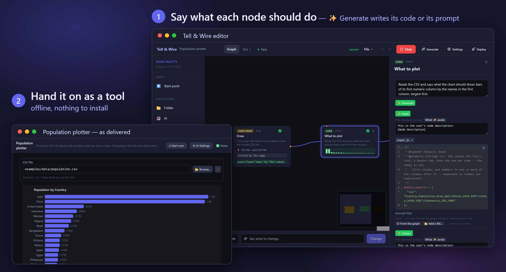

<div align="center">

# Tell & Wire

**A visual node editor: tell each step what it should do, wire the steps into a graph,
give it a GUI -- or write the tool as a notebook, a page with windows to use.**
**AI writes the code -- or you do. What you build is a folder of plain files that runs
wherever Node runs: offline, with a local model, if you like.**

### ⬇ [Windows](https://github.com/Archimedes79/Tell-and-Wire/releases/latest/download/tell-and-wire-windows.zip) · [Linux](https://github.com/Archimedes79/Tell-and-Wire/releases/latest/download/tell-and-wire-linux.zip)

Notebook only, a smaller download: [Windows](https://github.com/Archimedes79/Tell-and-Wire/releases/latest/download/tell-and-wire-notebook-windows.zip) · [Linux](https://github.com/Archimedes79/Tell-and-Wire/releases/latest/download/tell-and-wire-notebook-linux.zip)



</div>

## What it is

Tell & Wire builds small software: a chart from a CSV, a summary of every file in a folder, a table of key
figures, a chat, a panel of AI reviewers -- anything you can draw as steps that hand data to each other. Two
products build it, on the same project format, and what one made the other opens.

**The editor** is a visual node editor. You design two things, each in its tab, and both end up as plain files:

- **The graph** (Graph tab). Software as **nodes** wired together. A run begins at a **start
  point**, passes through **code nodes**, **AI nodes**, **data nodes** (a struct the tool
  remembers) and **subgraphs**, and ends at **end points**. Each node says what goes in and
  what comes out, with an example each way. A schedule table says in which step each node runs
  -- and which may run side by side.
- **The GUI** (GUI tab). The page a person uses the tool through, in the browser: text, a file
  picker, a dropdown, a slider, a button, a chart, a table, a chat. A block starts the graph at a
  start point and shows what an end point hands back -- by name, nothing is wired to the GUI, so
  either half can be redesigned without touching the other. A chat shows how full the model's
  window is and, when a conversation grows long, has the model shorten it. The page is drawn in
  one of four colour schemes (Night, Paper, White, Graphite), the notebook's windows the same.

**The notebook** is a page you write, like any web page, with windows standing in it to be used. A window takes what
goes in -- text, a number, a choice, a file, a folder --, has a button, and shows what comes out: a table, text, a chart,
a picture or a chat, at a size that never grows. What a window does is a few cells, each a sentence -- *Summarize
@Text in @Length* -- done by a model or by code; the `@` names are the wires. Under the page are the open window's
cells, the window as the graph it is, and a debug view of every round. The page can be written as Markdown and
shown light or dark. It saves the same project files, so **Open in editor** shows its graph
([docs/notebook.md](docs/notebook.md)).

### Work the way you like

**No code: tell it.** A node is a heading and a few plain words about what it should do.
**Auto generate** has a model write the node's files from them -- what goes in and out, then
the code or the prompt -- and a chat for each file changes it as you say. A whole graph can be
drawn from one description, too -- and in the notebook a page of windows. A local model (Ollama, LM Studio) will do,
or an API of your choice.

**Code first: it is all files.** Every node is a folder of plain text: `input_example.js` and
`output.js`, and `code.js` or `prompt.md`. Open any of them in your own editor, change it, diff it in
git; the editor follows the folder. Nothing the AI wrote is out of reach, and nothing hides in a
format: a node's example is its test (▶ Try), and a run that went well can be kept as an offline test.

**Then hand it on.** ▶ Run shows the tool in the App tab, as its user will see it. **File →
Deploy as zip** writes a folder that anyone with Node can unzip and start: the GUI in a browser,
the graph behind it, offline. A tool made in the notebook is handed on the same way: open it in the editor and deploy it.

### How it fits together


The picture is the architecture the software is cut by: every box is a folder or a few, and
[docs/architecture.md](docs/architecture.md) takes it apart box by box. [The same picture with each box's
folders and key files](docs/images/overview-detail.svg) is drawn by code from the folders and the document, and a test
fails when it is out of date.

- **Design, files and execution are apart.** The editor and the notebook only design; what they make is a folder;
  a deployment runs the folder. That is why a tool can be saved, versioned, handed on and run
  without the editor.
- **Two products, one project format.** The editor and the notebook have their own pages, servers
  (ports 8000 and 8100) and downloads, and import nothing of each other; what both need is common
  code underneath, and each has a button that opens the project in the other. They write the same
  files, so what the notebook made opens in the editor as a graph (a graph is not always a page, so
  the notebook opens only what it made).
- **Built for more than one language.** Nodes, wires, schedule and the definitions of what goes
  in and out are language-neutral files, and the engine that executes them is a part of its own,
  spoken to through a documented core protocol ([docs/architecture.md](docs/architecture.md)).
  JavaScript is the language that ships today; the design is made for language extensions, so
  the same graph can one day run in another.
- **Two models, two jobs.** One writes, in the editor; one runs the AI nodes, in the editor and in a
  delivered tool. Each can be a different model.
- **Read without running.** A GUI block can show what a data node holds without starting a round.

The editor and every deployed tool listen on `127.0.0.1` unless you start one with another
`--host` yourself, and there is no telemetry. A code node's JavaScript runs in a process of its
own: it reads the working directory (not `ai-settings.json`), writes only its own folder, starts
no program and holds no key. The network stays open to it.

## Tell & Wire and MCP

Tell & Wire is an editor for building tools. It is not an MCP server you add to an assistant for
general abilities; it meets the [Model Context Protocol](https://modelcontextprotocol.io) in two
specific ways:

- **It serves one**, for graphs. `node backend/cli/main.ts --mcp --mcp-root <folder>` starts an MCP
  server on stdio with nine tools -- the graph guide, have this machine's model write a graph,
  validate, save, run, run one node, test, list -- so an AI assistant can design and test Tell & Wire
  graphs in that folder.
- **It uses them**, in AI nodes. An AI node can call the tools of MCP servers. A web reader and a
  Word and PDF reader come with the download (`mcp/`), and any other can be added
  (*Tools for an AI node*, below).

## Download and start

Download [tell-and-wire-windows.zip](https://github.com/Archimedes79/Tell-and-Wire/releases/latest/download/tell-and-wire-windows.zip)
or [tell-and-wire-linux.zip](https://github.com/Archimedes79/Tell-and-Wire/releases/latest/download/tell-and-wire-linux.zip)
(x64, Node.js included), unzip it and start `run.cmd` (Windows) or `./run.sh` (Linux). The
editor opens in your browser on <http://127.0.0.1:8000>, or on the next free port. Older
versions are on the [releases page](https://github.com/Archimedes79/Tell-and-Wire/releases).

**Notebook only.** [tell-and-wire-notebook-windows.zip](https://github.com/Archimedes79/Tell-and-Wire/releases/latest/download/tell-and-wire-notebook-windows.zip) or
[tell-and-wire-notebook-linux.zip](https://github.com/Archimedes79/Tell-and-Wire/releases/latest/download/tell-and-wire-notebook-linux.zip) is the smaller download: the
notebook and its examples, without the graph editor and the tool servers. Unzip it and start `run.cmd` or `./run.sh`;
the notebook opens on <http://127.0.0.1:8100>, or on the next free port. Open the examples with **Open…**
(`notebook-examples/`). Both can run side by side.

## Run from source

Node 24 or newer, on Windows, macOS or Linux:

```bash
git clone https://github.com/Archimedes79/Tell-and-Wire.git
cd Tell-and-Wire
./start.sh        # macOS, Linux
.\start.ps1       # Windows PowerShell (a bare `start` is a PowerShell command)
start.cmd         # Windows cmd, or double-click it
```

The launcher installs on first use, builds the page when its sources changed, restarts an
editor already on the port and opens the browser; `stop.*` stops it. By hand it is
`npm ci`, `npm run build`, then `npm start` (`node backend/cli/main.ts --editor frontend/dist`).
`npm run dev` serves the page with live reload on <http://127.0.0.1:3000>. Keep a checkout
out of folders that Dropbox or OneDrive sync: they lock files during `npm ci` and the build.

The notebook starts the same way with `start-notebook.sh`, `start-notebook.ps1` or `start-notebook.cmd` (on
<http://127.0.0.1:8100>; `stop-notebook.*` stops it), and `npm run package:notebook` writes its small zip.

A graph also runs without the editor. Paths inside a graph resolve against the working
directory, so run the examples from the repository root:

```bash
node backend/cli/main.ts examples/population_plotter          # run once, print the result as JSON
node backend/cli/main.ts check examples/population_plotter    # what is wrong, without running
node backend/cli/main.ts test --offline examples/nested_statistics   # node examples and kept runs
node backend/cli/main.ts my_tool --serve                      # serve its GUI
node backend/cli/main.ts my_tool --bundle ./out               # write a deployable folder
node backend/cli/main.ts --mcp --mcp-root ./tools             # an MCP server on stdio
```

## Set up a model

**Auto generate** asks a model to write a node's files, and an AI node asks one each time it runs.

Open **⚙ Settings**, fill in what you need, press **Save** (the notebook has no settings dialog of its own: it reads
the same `ai-settings.json` and variables, so set it up once, here, or by editing the file):

- **AI that runs the nodes** and **AI that writes**: a provider and a model each. The first
  serves every AI node that does not name its own model, a code node's `node.llm`, ▶ Try and
  every run, also in a delivered tool. The second serves Auto generate (a node's code and prompt, a whole
  graph, the bar under the canvas) and is the first one until you set it apart -- a larger
  model may be worth it for writing, a small one enough for the nodes, or the other way round.
- Under the provider you choose, what it needs: **the address of its server** (Ollama, LM Studio
  or any server that speaks the OpenAI API -- on this computer or another one the editor can
  reach, for example `http://192.168.1.20:11434`) or **an API key**. Keys are write-only: saved
  on this machine, never shown again. *All keys and server addresses* lists every one.

**Help** (top right) has *Getting started* and the whole user guide.

Settings are saved in `ai-settings.json`. It is looked for in the working directory, then in the
folder that holds `graph/` (beside `run.sh` in a download or a bundle), then as
`~/.tell-and-wire/settings.json`; `TW_SETTINGS` names one file instead. The file is
gitignored; `ai-settings.example.json` shows its shape. Environment variables win over the
file: `TW_AI_PROVIDER`, `TW_AI_MODEL` (the nodes), `TW_WRITING_PROVIDER`, `TW_WRITING_MODEL`
(writing), `TW_CONTEXT_TOKENS` (how much the nodes' model takes in at once, for a chat block's counter), and the key and address variables below.

| Provider (id) | Cost | Key or address |
|---|---|---|
| Ollama (`ollama`) | free, local | `OLLAMA_BASE_URL` (default `http://localhost:11434`) |
| LM Studio (`lmstudio`) | free, local | `LMSTUDIO_BASE_URL` (default `http://localhost:1234/v1`) |
| Google Gemini (`google`) | free tier | `GOOGLE_API_KEY`, from [aistudio.google.com/apikey](https://aistudio.google.com/apikey) |
| GitHub Models (`github_copilot`) | free tier | `GITHUB_TOKEN` with the `models:read` scope |
| OpenAI (`openai`) | paid | `OPENAI_API_KEY` |
| Anthropic (`anthropic`) | paid | `ANTHROPIC_API_KEY` |
| OpenAI-compatible (`openai_compatible`) | depends | `OPENAI_COMPATIBLE_BASE_URL`, `OPENAI_COMPATIBLE_API_KEY` |

With nothing set, Tell & Wire uses a local model server that is running (Ollama or
LM Studio), else Ollama, and the editor says at once if that is not running. For Gemini, use
the `-latest` model names; dated names are retired. Ollama is asked for a context window as large
as the request (4096 to 32768 tokens), since it cuts a longer prompt silently at its own default.

A small local model slips now and then: an empty answer, broken JSON, a key left out. Tell & Wire
asks again before a node fails (`TW_AI_ATTEMPTS`, `TW_AI_REPAIRS`; see
[docs/architecture.md](docs/architecture.md)).

**Tools for an AI node.** An AI node can call tools from [MCP](https://modelcontextprotocol.io)
servers. In *the node's settings → Tools the model may use*, **+ Add MCP server** offers the ones
that come with Tell & Wire -- a web reader and a Word and PDF reader, each with the settings it
needs -- and takes any other, by a name that the machine's own settings file
(`TW_SETTINGS`, else `~/.tell-and-wire/settings.json`) defines:

```json
{ "mcp_servers": {
    "filesystem": { "command": "npx", "args": ["-y", "@modelcontextprotocol/server-filesystem", "C:/data"] },
    "internal":   { "url": "https://mcp.example.com/mcp", "headers": { "Authorization": "Bearer …" } } } }
```

A graph can name a server but never the command or the address of one, so a graph someone
hands you cannot start a program of its choosing or post its data to a stranger's server. A
Word file is read by the `documents` server, not by the nodes. A server started by `command` does not
inherit variables named like keys, tokens, secrets or passwords from the environment: give
it what it needs in its own `env`. A tool call gets two minutes
(`TW_MCP_TIMEOUT_MS`, `0` for none), and the model at most eight turns of calls per answer.

## Docker

```bash
docker compose up --build    # the editor beside an Ollama container, on 127.0.0.1:8000
docker run -p 127.0.0.1:8000:8000 -v ./data:/app/data ghcr.io/archimedes79/tell-and-wire:latest
```

## Examples

[`examples/`](examples/) holds nine tools, each a folder; open one with **File → Open…**. The
simplest are population_plotter (choose a CSV, see a chart; no model), folder_summaries
(a summary of each file in a folder) and chat (a chat block and an AI node). counter
remembers in a data node: a button counts up, no model, and the wire back to the node that adds one
reads the count as it was when the round began. net_pay is a code node of three files:
code.js loads the tax rule in tax.js and the bonus in rates.json that stand beside it.
file_summarizer starts one run from a picker, a dropdown and a button. nested_statistics
shows a subgraph, a hand-written gui and a kept test. paper_review_panel and
portfolio_review are teams of AI reviewers.

[`notebook-examples/`](notebook-examples/) holds five notebook pages, each a project the notebook opens with **Open…**:
sales_report (a CSV into a table of key figures and a chart), text_toolbox (numbers from code, a summary from a model),
badge_maker (a picture a code cell draws for the room it has), picture_sheet (a folder of pictures side by side, each
described by a model) and tip_calculator (a bill split, no model).

## Documentation

- [docs/user-guide.md](docs/user-guide.md): how to build a tool, step by step.
- [docs/notebook.md](docs/notebook.md): the notebook, a tool said as a page of windows.
- [docs/architecture.md](docs/architecture.md): the overview picture taken apart box by box with
  its folders, the rules between them, the tool's folder format, the host's APIs and the core
  protocol, what a package carries, and how to extend Tell & Wire.
- [mcp/](mcp/README.md): the tool servers that come with Tell & Wire -- they let an AI node read web
  pages and Word and PDF files -- and how a server brings its own settings.

## Licence

Source-available under [PolyForm Noncommercial 1.0.0](LICENSE), not open source:
noncommercial use is free, commercial use needs a separate licence (open an issue), and
what you build is yours.

## Trademarks

Ollama, LM Studio, OpenAI, Anthropic, Google Gemini, GitHub Models, Node.js and the other
product names in this document belong to their owners. Tell & Wire is not affiliated with
or endorsed by them; the names only say what it can connect to or run on.
